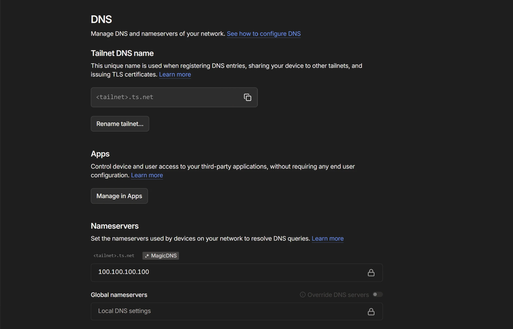
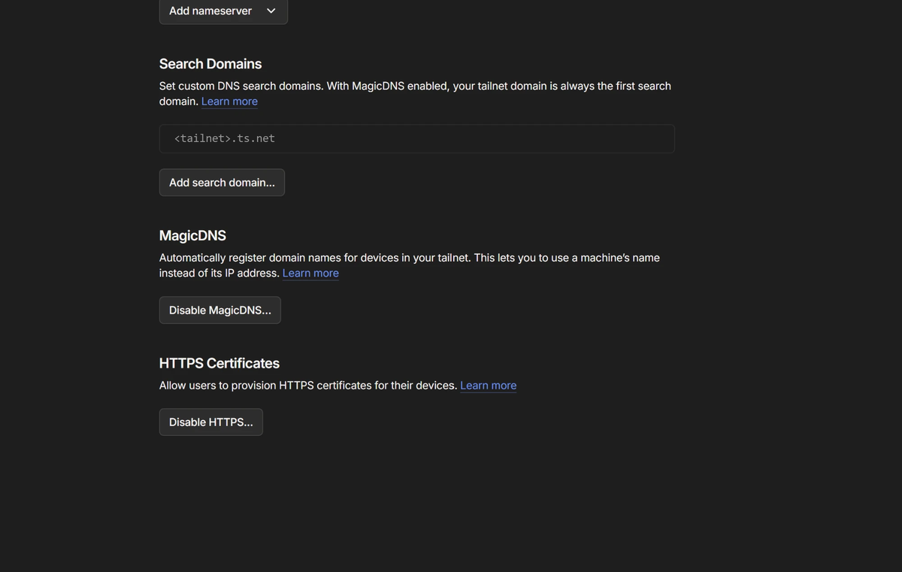
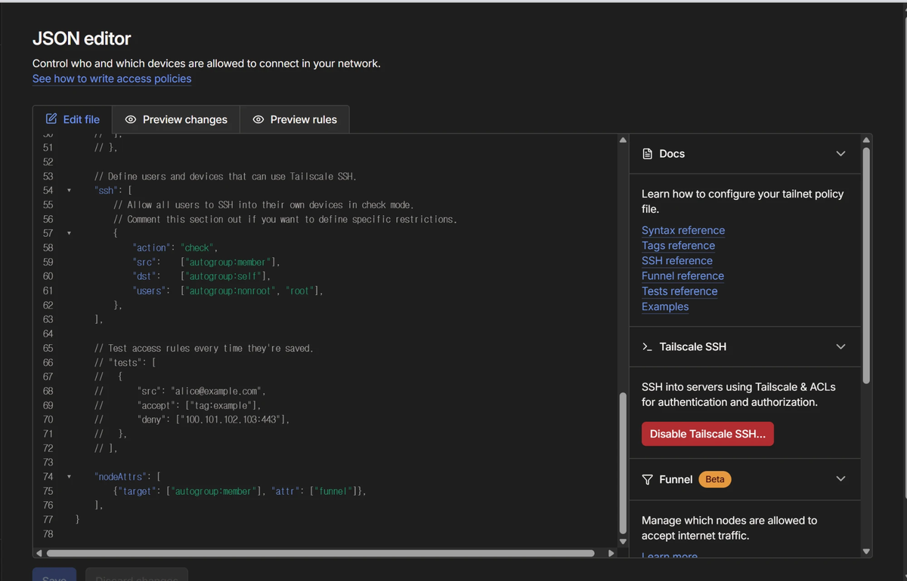

# 음소 노드 추가하기 — 관리자 안내

> 노드가 **모두** 실패할 때의 대체(클라우드 발음 평가·HF Space) → [FALLBACK.md](FALLBACK.md)

음소 노드는 사용자 녹음에서 **실제 소리 기준으로 음소를 찾는** PC 다. 여러 대를 붙이면 한 대가 꺼져도 다른 대가 이어받는다.
노드가 한 대도 없어도 서비스는 정상이다(말하기 결과에서 "소리 분석" 줄만 빠진다).

```
사용자 → Render(/speak-check) ──▶ 노드 1 (https://pc1.<tailnet>.ts.net)   먼저 시도
                              └──▶ 노드 2 (https://pc2.<tailnet>.ts.net)   1번이 안 되면
```

새 PC 하나를 붙이는 데 드는 일: **관리자 2분 + 노드 PC 10분(대부분 다운로드 대기)**.

---

## 한눈에 보는 순서

| # | 누가 | 할 일 | 결과 |
|---|---|---|---|
| 1 | 관리자 | 새 PC 를 tailnet 에 들이고, 토큰을 전달 | 노드 PC 가 준비됨 |
| 2 | 노드 PC | `join_node.cmd` 더블클릭 → 토큰 붙여넣기 | 화면에 `https://….ts.net` 주소 |
| 3 | 관리자 | `check_phoneme_nodes.py` 로 점검 | Render 에 넣을 한 줄 |
| 4 | 관리자 | Render 에 그 한 줄 붙여넣기 | 끝 |

---

## 0. 처음 한 번만 — Tailscale 관리 콘솔 설정 (이미 했으면 건너뛴다)

2026-11-04 에 첫 노드를 붙이면서 끝냈다. **새 tailnet 을 만들 때만** 다시 한다. 관리 콘솔 소유자(owner)·관리자만 바꿀 수 있다.
안 하면 노드 PC 에서 `funnel_on.cmd`·`join_node.cmd` 가 아래 메시지로 멈춘다.

| 메시지 | 빠진 설정 |
|---|---|
| `Funnel not available; HTTPS must be enabled.` | 0-1 HTTPS 인증서 |
| `Funnel not available; "funnel" node attribute not set.` | 0-2 정책 파일 `nodeAttrs` |

> 아래 화면의 `<tailnet>.ts.net` 은 실제 tailnet 이름을 가린 자리다. 문서·이슈·채팅에 실제 이름·기기 주소를 붙이지 않는다.

### 0-1. MagicDNS 와 HTTPS 인증서 켜기 — DNS 화면

[https://login.tailscale.com/admin/dns](https://login.tailscale.com/admin/dns)

1. 맨 위 **Tailnet DNS name** 에 `<무언가>.ts.net` 이 있다. 노드 주소는 `https://<PC 이름>.<이 이름>` 이 된다(따로 적을 필요 없다 — `join_node.cmd` 가 알려 준다).
2. 아래로 내려 **MagicDNS** — 버튼이 `Enable MagicDNS` 면 누른다. `Disable MagicDNS…` 로 보이면 **이미 켜진 것**이다.
3. 맨 아래 **HTTPS Certificates** — 버튼이 `Enable HTTPS` 면 누르고 확인한다. `Disable HTTPS…` 로 보이면 **이미 켜진 것**이다.





### 0-2. Funnel 허용 — Access controls → JSON editor

[https://login.tailscale.com/admin/acls/file](https://login.tailscale.com/admin/acls/file)

1. **Access controls** 화면에서 **JSON editor**(파일 편집)를 연다. 위에 `Edit file` · `Preview changes` · `Preview rules` 탭이 보이는 화면이다.
   - 버튼으로 규칙을 만드는 **시각 편집기(Grants·App 칸)** 가 아니다. App 칸의 목록(`tailscale.com/cap/drive` 등)에는 Funnel 이 없다.
2. 파일 **맨 끝의 닫는 `}` 바로 위**에 아래를 붙여 넣는다.
   ```json
   	"nodeAttrs": [
   		{"target": ["autogroup:member"], "attr": ["funnel"]},
   	],
   ```
   - 이미 `"nodeAttrs": [ … ]` 가 있으면 새로 만들지 말고, 그 대괄호 안에 `{"target": ["autogroup:member"], "attr": ["funnel"]},` 한 줄만 넣는다(같은 키가 두 번이면 저장이 거부된다).
   - 이 파일은 끝 쉼표를 허용한다(HuJSON).
3. 아래 **Save** 를 누른다. 빨간 오류가 뜨면 괄호·따옴표를 다시 본다.
4. 1~2분 뒤 노드 PC 에서 `funnel_on.cmd`(또는 `join_node.cmd`)를 다시 실행한다.



`autogroup:member` = 이 tailnet 의 모든 사용자 기기. 노드 PC 만 허용하려면 기기에 태그를 붙이고 `"target": ["tag:phoneme-node"]` 로 좁힐 수 있다
(태그는 `tagOwners` 정의가 필요하다 — 처음에는 위 그대로 둔다).

### 0-3. 토큰

관리자 PC 의 `backend\phoneme-node\token.txt` 가 **모든 노드가 같이 쓰는 토큰**이다. Render 의 `PHONEME_TOKEN` 과 같은 값.
없으면 `make_token.cmd` 로 만든다.

### 0-4. 노드 PC 를 고를 때

- **늘 켜 둘 PC** 여야 한다. 노트북이면 절전·덮개 닫힘·꺼짐 때 음소 분석이 같이 멈춘다(채점은 계속된다).
- `serve_phoneme.bat` 를 손으로 띄운 **창을 닫으면 노드도 꺼진다.** `register_task.cmd`(또는 `join_node.cmd`)로 숨김 자동 실행을 등록한 뒤 창을 닫는다.
  같은 포트가 이미 쓰이는 중이면 중복으로 띄우지 않으므로 순서는 상관없다.

---

## 1. 관리자: 새 PC 준비시키기

1. **tailnet 에 들이기** — 둘 중 하나
   - 그 PC 에서 관리자와 **같은 Tailscale 계정**으로 로그인, 또는
   - 관리 콘솔 → **Users → Invite users** 로 그 사람을 초대(초대받은 사람은 `autogroup:member` 라 Funnel 이 바로 허용된다)
2. **토큰 전달** — `token.txt` 의 한 줄을 **메신저 비밀 대화·직접 전달** 등으로 준다.
   공개 채팅방·이슈·커밋에 붙이지 않는다(이 값만 있으면 누구나 노드에 음성을 보낼 수 있다).
3. 노드 PC 사람에게 이 문서의 **2번**을 보내 준다.

## 2. 노드 PC: `join_node.cmd` 한 번

**준비물** (없으면 먼저 설치)

| 항목 | 확인 |
|---|---|
| Windows 10/11, 디스크 여유 1GB | |
| Python 3.10 이상 | python.org 에서 설치, 첫 화면 **"Add python.exe to PATH" 체크** |
| Tailscale | 설치 후 1번에서 안내받은 계정으로 로그인(작업 표시줄 아이콘이 연결됨) |
| 저장소 | `git clone https://github.com/01044402345o-beep/codyssey_final` — git 이 없으면 관리자에게 저장소 폴더를 통째로 받는다 |
| 전원 | 설정 → 시스템 → 전원: **절전 안 함**(노드는 켜져 있어야 쓰인다) |

**실행**

1. 저장소의 `backend\phoneme-node` 폴더를 연다.
2. **`join_node.cmd` 더블클릭.**
3. `Paste the token…` 이 나오면 관리자에게 받은 토큰을 붙여넣고 Enter.
4. 기다린다(처음엔 모델 317MB 등 약 400MB 다운로드). 단계가 `[1/6]` … `[6/6]` 으로 진행된다.
5. 끝나면 이렇게 나온다 — **이 주소를 관리자에게 보낸다.**
   ```
   DONE. Send this address to the admin:
       https://<이 PC 이름>.<tailnet>.ts.net
   ```
   (같은 주소가 `node-url.txt` 에도 저장된다)

`join_node.cmd` 가 하는 일: 토큰 저장 → 가상환경·패키지·모델(SHA256 확인) 준비 → **로그온하면 창 없이 자동 시작** 등록 →
모델 준비될 때까지 대기 → Funnel 로 공개 주소 열기 → 공개 주소 확인. **여러 번 실행해도 안전하다**(중간에 멈췄으면 그냥 다시 실행).

- 아무도 로그온하지 않아도(부팅만 해도) 돌게 하려면: `join_node.cmd startup` 을 **관리자 권한으로 실행**.

## 3. 관리자: 점검하고 Render 값 만들기

관리자 PC 의 저장소 폴더에서, **우선순위 순서대로** 주소를 나열한다(앞이 먼저 쓰인다):

```
python tools\check_phoneme_nodes.py https://<PC1>.<tailnet>.ts.net https://<PC2>.<tailnet>.ts.net
```

출력 예:

```
[OK  ] https://<PC1>.<tailnet>.ts.net  healthz 94ms · 분석 515ms
[OK  ] https://<PC2>.<tailnet>.ts.net  healthz 120ms · 분석 640ms

Render → Environment 에 넣을 값 (통과한 노드만, 입력 순서 = 우선순위):

PHONEME_REMOTE_URLS=https://<PC1>.<tailnet>.ts.net,https://<PC2>.<tailnet>.ts.net
```

- 무음 1초만 보내 점검한다(사용자 음성 없음). `[FAIL]` 이면 아래 **문제 해결**을 본다.
- **통과한 노드만** 마지막 줄에 들어간다. FAIL 이 있으면 그 노드를 고친 뒤 다시 돌린다.

## 4. 관리자: Render 에 붙여넣기

Render → **codyssey-api** → **Environment**

| 키 | 값 |
|---|---|
| `PHONEME_REMOTE_URLS` | 3번 마지막 줄의 `=` 뒤 전체 |
| `PHONEME_TOKEN` | 그대로 둔다(모든 노드가 같은 토큰) |
| `PHONEME_REMOTE_URL` | **삭제** — 목록(`…_URLS`)이 있으면 단일 주소는 쓰지 않지만, 헷갈리지 않게 지운다 |

**Save Changes** → 자동 재배포(1~2분). 확인: 앱에서 말하기를 한 번 해서 결과에 `소리 분석(실제 음성)` 줄이 나오면 연결된 것이다.
노드별 상태(살아 있음·실패 횟수·쉬는 시간)는 관리자 토큰으로 `/health` 상세의 `phoneme_node` 에 나온다.

---

## 노드 빼기 · 바꾸기 · 토큰 바꾸기

| 하고 싶은 것 | 방법 |
|---|---|
| 노드 하나 빼기 | Render `PHONEME_REMOTE_URLS` 에서 그 주소를 지우고 저장. 그 PC 에서는 `unregister_task.cmd` + `funnel_off.cmd` |
| 우선순위 바꾸기 | `PHONEME_REMOTE_URLS` 의 순서만 바꾼다(앞이 먼저) |
| 잠깐 점검 중 | 아무것도 안 해도 된다 — 꺼진 노드는 본체가 알아서 60초씩 쉬게 하고, 30초마다 확인해 살아나면 되돌린다 |
| 토큰 바꾸기(유출 의심 등) | 관리자 PC: `token.txt` 삭제 → `make_token.cmd` → **모든 노드 PC 의 `token.txt` 를 새 값으로** 바꾸고 `unregister_task.cmd` → `join_node.cmd` → Render `PHONEME_TOKEN` 갱신. 하나라도 옛 토큰이면 그 노드는 401 로 빠진다 |
| 음소 분석 전부 끄기 | Render 에서 `PHONEME_REMOTE_URLS`(와 `PHONEME_REMOTE_URL`) 삭제 — 본체가 노드를 부르지 않는다 |

## 문제 해결

| 증상 (`check_phoneme_nodes.py` 또는 `join_node.cmd`) | 원인 | 할 일 |
|---|---|---|
| `Python 3.10+ not found` | Python 없음·PATH 안 잡힘 | python.org 에서 설치, "Add python.exe to PATH" 체크 후 다시 |
| `pip install failed` | 네트워크·프록시 | `logs\server.log` 확인 후 다시 실행 |
| `Funnel is not on` / `HTTPS must be enabled` | tailnet HTTPS 꺼짐 | 0번의 HTTPS Certificates 켜기 |
| `"funnel" node attribute not set` | 정책에 funnel 없음, 또는 그 PC 가 다른 tailnet | 0번의 nodeAttrs 확인, 1번처럼 같은 tailnet 에 들이기 |
| `/healthz 안 닿음` | PC 꺼짐·절전·노드 안 뜸·Funnel 꺼짐 | 그 PC 에서 `check_node.cmd` |
| `모델 준비 전` | 부팅 직후 로딩 중 | 1분 뒤 다시 |
| `토큰 불일치(401)` | 그 PC 의 `token.txt` 가 다름 | 관리자 토큰으로 바꾸고 `unregister_task.cmd` → `join_node.cmd` |
| `https:// 주소가 아님` | LAN(192.168.x)·Tailscale IP(100.x) 주소를 넣음 | Render 는 클라우드라 닿지 않는다. `join_node.cmd` 가 준 `https://….ts.net` 을 쓴다 |

## 알아둘 것

- **같은 집 PC 두 대는 정전·인터넷 단절 때 함께 꺼진다.** 다른 장소(예: 학교 PC + 집 PC)에 두어야 진짜 대비가 된다.
- **개인정보**: 사용자 녹음이 그 PC 로 간다(앱 동의 v8 ④). 새 PC 를 붙이면 `docs/product/privacy-policy-draft.md` 의
  "팀 운영 음소 분석 PC" 행에 **위치(국가)** 를 적는다. 노드는 음성을 저장하지 않고 로그에도 남기지 않는다.
- 노드는 사용자 PC 의 메모리를 약 410MB 쓴다. 게임·영상 편집 등 무거운 작업 중에는 응답이 느려질 수 있다(본체는 6초에서 포기하고 넘어간다).
- 자세한 동작(페일오버·복구 규칙, 환경변수)은 [SETUP.md](SETUP.md) 4-1절.
