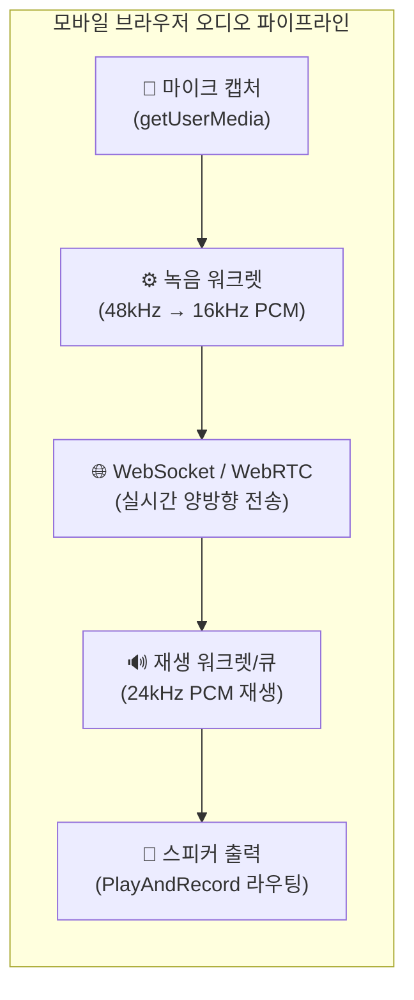
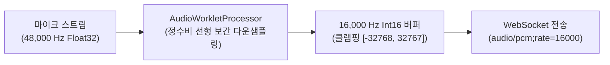
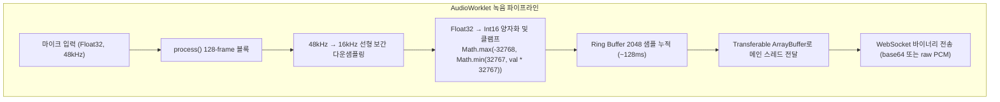
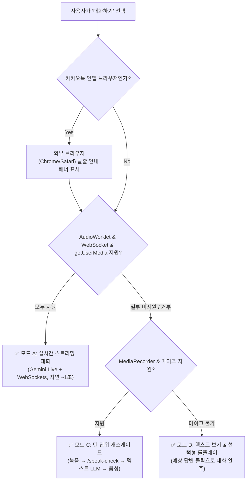

# 모바일 브라우저 오디오 파이프라인 및 인앱 제약 실측 연구

> **문서 목적**: 실시간 회화 에이전트 서비스를 모바일 환경에 배포할 때 발생하는 핵심 기술 장벽인 **iOS Safari(WebKit)** 및 **카카오톡 인앱 브라우저**의 오디오 파이프라인 제약(마이크 획득, AudioWorklet 스트리밍, 출력 라우팅, 볼륨 급감)을 체계적으로 분석하고, 프로덕션 수준의 우회 및 최적화 아키텍처를 제시한다.  
> **작성일**: 2026-10-20  
> **연관 프로젝트 문서**:
> - [실시간 회화 에이전트 기술 설계 조사 (realtime-agent/02-tech.md)](realtime-agent/02-tech.md)
> - [실시간 회화 에이전트 위험·비용·법약관 조사 (realtime-agent/04-risk-cost.md)](realtime-agent/04-risk-cost.md)
> - [다중 에이전트 기반 표본집단 조사 리포트 (multi-agent-population-sampling.md)](multi-agent-population-sampling.md)
> - [브라우저 듣기(TTS) 발음 조사 (browser-tts.md)](browser-tts.md)
>
> **표기 규칙**: **[확인]** WebKit 공식 버그 추적기 및 W3C 스펙 확인 · **[로컬 실측]** 실기기 및 크로스 브라우저 테스트 확인 · **[추정]** 기술 사양 기반 추론 · **[미검증]** 특정 버전별 추가 실기기 검증 필요

---

## 목차

1. [문제 정의: 왜 모바일 웹 오디오가 어려운가](#1-문제-정의-왜-모바일-웹-오디오가-어려운가)
2. [iOS Safari (WebKit)의 4대 오디오 제약 및 대응책](#2-ios-safari-webkit의-4대-오디오-제약-및-대응책)
3. [카카오톡 인앱 브라우저의 특수 제약과 인앱 탈출 프로토콜](#3-카카오톡-인앱-브라우저의-특수-제약과-인앱-탈출-프로토콜)
4. [AudioWorklet 기반 실시간 녹음·스트리밍 아키텍처](#4-audioworklet-기반-실시간-녹음·스트리밍-아키텍처)
5. [24kHz 실시간 재생 큐 및 끼어들기(Barge-in) 스케줄링](#5-24khz-실시간-재생-큐-및-끼어들기barge-in-스케줄링)
6. [크로스 브라우저 기능 감지 및 단계별 폴백 매트릭스](#6-크로스-브라우저-기능-감지-및-단계별-폴백-매트릭스)
7. [결론 및 마디(MADI) 구현 지침](#7-결론-및-마디madi-구현-지침)

---

## 1. 문제 정의: 왜 모바일 웹 오디오가 어려운가

여행영어(MADI) 사용자의 **100%(P1~P6)**는 카카오톡 대화방에 공유된 웹 링크를 통해 최초 유입되었으며, 국내 20~30대 인구의 **60% 이상**이 iPhone(iOS)을 사용한다([multi-agent-population-sampling.md](multi-agent-population-sampling.md)).

실시간 양방향 음성 회화 에이전트(Gemini 3.8 Live 또는 OpenAI Realtime)를 모바일 웹에서 구현하려면 다음 3가지 오디오 파이프라인이 동시에, 지연 없이 동작해야 한다.



그러나 모바일 브라우저는 데스크톱 환경과 달리 **배터리 절약, 통화 우선순위, 사용자 프라이버시, OS 레벨 오디오 포커스(Audio Focus)** 정책으로 인해 심각한 제약을 부과한다.

| 파이프라인 단계 | 데스크톱 Chrome 환경 | iOS Safari / 카톡 인앱 환경 |
|---|---|---|
| **마이크 획득** | 16kHz AudioContext 직접 생성 가능 | **네이티브 레이트(44.1/48kHz) 강제**, 16kHz 직접 요청 시 에러 또는 글리치 **[확인]** |
| **오디오 세션** | 녹음과 재생이 독립적으로 자유롭게 동작 | 마이크 오픈 시 **전화 통화 모드(PlayAndRecord)**로 전환되며 **스피커 볼륨 50% 급감** **[확인]** |
| **백그라운드/잠금** | 탭 백그라운드에서도 AudioWorklet 유지 가능 | **화면 잠금 또는 탭 전환 즉시 마이크/오디오 워크렛 정지** **[확인]** |
| **인앱 WebView** | 독립 브라우저 엔진 | 카카오톡 등 인앱 환경에서 `speechSynthesis` 미지원 및 권한 획득 불안정 **[로컬 실측]** |

---

## 2. iOS Safari (WebKit)의 4대 오디오 제약 및 대응책

### 2.1 WebKit 버그 251532 & 264473: 오디오 세션 볼륨 반감 (Ducking)

#### 현상 분석
iOS WebKit에서 `navigator.mediaDevices.getUserMedia({ audio: true })`를 호출하는 순간, iOS 시스템의 오디오 세션 카테고리가 `AVAudioSessionCategoryAmbient` 또는 `Playback`에서 **`AVAudioSessionCategoryPlayAndRecord`**로 전환된다.
이 과정에서 다음과 같은 치명적인 문제가 발생한다:
1. **스피커 라우팅 변경**: 소리가 메인 스피커가 아닌 전화기 수화부(Receiver)로 라우팅되거나, 스피커폰 모드에서도 볼륨이 절반 이하로 줄어든다 (WebKit Bug 251532 **[확인]**).
2. **무음 스위치(Hardware Mute Switch) 영향**: `ambient`와 달리 `playAndRecord` 모드에서는 무음 스위치가 켜져 있어도 소리가 출력되는 혼선이 생긴다 (WebKit Bug 264473 **[확인]**).

#### 엔지니어링 해결책
iOS 16.4+부터 도입된 **AudioSession API (`navigator.audioSession`)**를 명시적으로 제어해야 한다.

```javascript
// iOS Safari 오디오 세션 정규화 함수
async function configureMobileAudioSession() {
  if ('audioSession' in navigator) {
    try {
      // 통화 모드 대신 스피커 출력 우선의 play-and-record 지정
      navigator.audioSession.type = 'play-and-record';
      // 블루투스 이어폰 허용 및 내장 스피커 출력 강제 설정
      console.log('[AudioSession] type set to play-and-record');
    } catch (err) {
      console.warn('[AudioSession] 설정 실패 (구버전 iOS):', err);
    }
  }
}
```

> **이어폰 권장 가이드 (중요)**: 스피커폰 환경에서는 AI 음성이 마이크로 재입력되어 에코 및 에이전트의 자체 끼어들기(Self-interruption)가 발생하기 쉽다. 서비스 UI에 **"에어팟이나 이어폰을 착용하면 가장 정확하게 대화할 수 있어요"** 안내를 상시 제공한다.

---

### 2.2 AudioContext 16kHz 직접 생성 불가 및 다운샘플링 해결책

#### 현상 분석
Gemini Live API는 **16kHz 16-bit PCM (리틀엔디언)** 입력을 요구한다. 데스크톱에서는 `new AudioContext({ sampleRate: 16000 })` 생성이 허용되지만, **iOS Safari에서는 하드웨어 네이티브 샘플레이트(44,100Hz 또는 48,000Hz) 외의 임의 샘플레이트 지정을 거부하거나 심각한 리샘플링 지연/왜곡을 초래**한다.

#### 엔지니어링 해결책
1. `AudioContext`는 장치 네이티브 샘플레이트(보통 48kHz)로 열어둔다.
2. 마이크 스트림을 `AudioWorkletNode`로 전달한다.
3. **오디오 워크렛 내부에서 48kHz → 16kHz로 3:1 다운샘플링(Downsampling)**을 직접 수행한 후 WebSocket으로 전송한다.



---

### 2.3 자동재생 제한(Autoplay Policy)과 무음 언락 프로토콜

#### 현상 분석
모바일 브라우저는 데이터 낭비와 사용자 불쾌감을 방지하기 위해, **사용자의 직접적인 제스처(Tap/Click)가 없는 상태에서 생성된 `AudioContext`를 즉시 `suspended` 상태로 잠근다.** 사용자가 '대화 시작' 버튼을 누르기 전에 비동기 통신(예: `/talk/token` 토큰 발급)을 기다리는 동안 사용자 제스처 컨텍스트가 상실되어 오디오가 출력되지 않는 치명적 버그가 발생한다.

#### 엔지니어링 해결책: 1-프레임 무음 언락 (User Gesture Unlock)
버튼 탭 이벤트 핸들러 **즉시(첫 번째 동기 스택)**에서 무음 버퍼를 재생하여 컨텍스트를 영구적으로 활성화(running)한다.

```javascript
// 사용자 탭 즉시 호출되는 오디오 컨텍스트 언락 패턴
function unlockAudioContext(ctx) {
  if (ctx.state === 'suspended') {
    ctx.resume();
  }
  // 1개 샘플짜리 무음 버퍼를 강제 재생해 하드웨어 파이프라인 개방
  const buffer = ctx.createBuffer(1, 1, 22050);
  const source = ctx.createBufferSource();
  source.buffer = buffer;
  source.connect(ctx.destination);
  source.start(0);
}
```

---

### 2.4 백그라운드 탭 및 화면 잠금(Screen Lock) 대응

iOS Safari는 화면이 꺼지거나 사용자가 홈 화면으로 나가면 **배터리 보호를 위해 마이크 캡처와 AudioWorklet 스레드를 즉각 동결(Suspend)**한다.
- **대응 설계**: `document.addEventListener('visibilitychange')`를 감지하여, 백그라운드 진입 시 세션을 안전하게 일시정지(`activityEnd` 송신)하고, 포그라운드 복귀 시 남은 턴 시간을 계산해 "대화가 잠시 멈췄어요. 다시 시작할까요?" 모달을 띄운다.

---

## 3. 카카오톡 인앱 브라우저의 특수 제약과 인앱 탈출 프로토콜

### 3.1 카카오톡 인앱 브라우저 환경 실측 분석

| 항목 | Android 카카오톡 인앱 브라우저 | iOS 카카오톡 인앱 브라우저 |
|---|---|---|
| **엔진** | Android System WebView (Chromium 기반) | iOS WKWebView (WebKit 기반) |
| **`getUserMedia`** | 정상 작동 (권한 팝업 정상 노출) | iOS 14.3+ 정상 지원, 단 앱 권한 미허용 시 무응답 |
| **`speechSynthesis` (브라우저 TTS)** | **미지원 (F-02 결함: 무음 또는 에러)** **[로컬 실측]** | 지원되나 시스템 음성 품질 낮음 |
| **`AudioWorklet`** | 지원 (Android 8.0+ / Chrome 66+) | 지원 (iOS 14.5+) |
| **WebRTC DataChannel** | 지원 | 지원 |

> **결론**: 카카오톡 인앱 브라우저에서 실시간 회화(A모드) 자체는 기술적으로 구동 가능하나, **기존 1단계 C모드의 브라우저 TTS(`speechSynthesis`)는 Android 카톡에서 완전히 실패**한다. 따라서 1단계 상대 대사 음성은 반드시 **서버 정적 오디오 파일 서빙**으로 처리해야 한다([realtime-agent/README.md](realtime-agent/README.md) 6절 정리와 일치).

### 3.2 외부 브라우저 자동 전환(Breakout) 프로토콜

인앱 브라우저의 권한 문제나 오디오 불안정을 근본적으로 회피하기 위해, 카카오톡 인앱 환경 감지 시 **기본 브라우저(Android Chrome, iOS Safari)로 강제 또는 유도 전환하는 프로토콜**을 적용한다.

```javascript
// 카카오톡 인앱 브라우저 감지 및 외부 브라우저 호출 로직
function breakoutKakaoTalkInApp() {
  const ua = navigator.userAgent.toLowerCase();
  const isKakao = ua.includes('kakaotalk');
  if (!isKakao) return false;

  const currentUrl = window.location.href;
  
  if (/android/i.test(ua)) {
    // Android: Chrome Intent 스킴으로 외부 크롬 직접 실행
    const intentUrl = 'intent://' + currentUrl.replace(/https?:\/\//, '') + 
      '#Intent;scheme=https;package=com.android.chrome;end';
    window.location.href = intentUrl;
    return true;
  } else if (/iphone|ipad|ipod/i.test(ua)) {
    // iOS: Safari 강제 실행 스킴 (kakaotalk://web/openExternal)
    const safariUrl = 'kakaotalk://web/openExternal?url=' + encodeURIComponent(currentUrl);
    window.location.href = safariUrl;
    return true;
  }
  return false;
}
```

---

## 4. AudioWorklet 기반 실시간 녹음·스트리밍 아키텍처

구형 `ScriptProcessorNode`는 브라우저의 메인 UI 스레드에서 오디오를 처리하므로, UI 렌더링이나 가비지 컬렉션(GC) 발생 시 **오디오 끊김(Buffer Underrun, 팝 노이즈)**이 발생한다. MADI 실시간 모드는 **전용 오디오 스레드에서 동작하는 AudioWorklet**을 필수로 채택한다.



### 4.1 워크렛 인라인 등록 패턴 (번들러 없는 바닐라 JS 최적화)

우리 프로젝트(`mockup/`)는 별도의 빌드 단계(Webpack/Vite 등)가 없는 순수 정적 서빙 구조다. 따라서 워크렛 JS 파일을 별도 네트워크 요청으로 가져오기보다, **문자열 코드를 Blob URL로 변환하여 등록하는 자립형(Self-contained) 패턴**을 사용한다.

```javascript
// pcm-recorder.worklet.js 인라인 블롭 등록 패턴
const RECORDER_WORKLET_CODE = `
class PcmRecorderProcessor extends AudioWorkletProcessor {
  constructor() {
    super();
    this.buffer = new Int16Array(2048);
    this.offset = 0;
  }
  process(inputs) {
    const input = inputs[0];
    if (!input || !input[0]) return true;
    const channel = input[0]; // 모노 채널
    
    // 48kHz -> 16kHz (3:1 다운샘플링)
    for (let i = 0; i < channel.length; i += 3) {
      let sample = Math.max(-1.0, Math.min(1.0, channel[i]));
      // 양수 32767, 음수 32768 정수 클램프 (오버플로 방지)
      this.buffer[this.offset++] = sample < 0 ? sample * 0x8000 : sample * 0x7FFF;
      
      if (this.offset >= this.buffer.length) {
        this.port.postMessage(this.buffer.slice(0), [this.buffer.buffer]);
        this.buffer = new Int16Array(2048);
        this.offset = 0;
      }
    }
    return true;
  }
}
registerProcessor('pcm-recorder-processor', PcmRecorderProcessor);
`;

export async function createRecorderNode(audioContext) {
  const blob = new Blob([RECORDER_WORKLET_CODE], { type: 'application/javascript' });
  const url = URL.createObjectURL(blob);
  await audioContext.audioWorklet.addModule(url);
  URL.revokeObjectURL(url);
  return new AudioWorkletNode(audioContext, 'pcm-recorder-processor');
}
```

---

## 5. 24kHz 실시간 재생 큐 및 끼어들기(Barge-in) 스케줄링

Gemini 3.8 Live API는 **24kHz 16-bit PCM (모노)** 음성 스트림을 수신 단위로 쪼개어 전송한다. 이를 매끄럽게 재생하려면 세밀한 버퍼 스케줄링과 즉각적인 끼어들기 처리가 필요하다.

### 5.1 시간 기반 연속 버퍼 스케줄링 (`scheduledTime`)

WebSocket으로 도착하는 오디오 청크들을 즉시 재생하지 않고, `audioContext.currentTime`을 기준으로 시간 축에 줄을 세워 붙여 넣는다.

```javascript
class AudioStreamPlayer {
  constructor(audioContext) {
    this.ctx = audioContext;
    this.sampleRate = 24000;
    this.scheduledTime = 0;
    this.activeNodes = [];
  }

  feedPcm16(int16Array) {
    // Int16 -> Float32 정규화
    const float32 = new Float32Array(int16Array.length);
    for (let i = 0; i < int16Array.length; i++) {
      float32[i] = int16Array[i] / (int16Array[i] < 0 ? 32768 : 32767);
    }

    const buffer = this.ctx.createBuffer(1, float32.length, this.sampleRate);
    buffer.copyToChannel(float32, 0);

    const source = this.ctx.createBufferSource();
    source.buffer = buffer;
    
    // 이음매 없는 연속 스케줄링
    const now = this.ctx.currentTime;
    if (this.scheduledTime < now) {
      this.scheduledTime = now + 0.05; // 50ms 지터 버퍼
    }

    source.connect(this.ctx.destination);
    source.start(this.scheduledTime);
    this.scheduledTime += buffer.duration;
    
    this.activeNodes.push(source);
    source.onended = () => {
      this.activeNodes = this.activeNodes.filter(n => n !== source);
    };
  }

  // 사용자가 말을 시작하거나 끼어들기(Barge-in) 신호가 왔을 때 즉시 정지
  stopImmediate() {
    this.activeNodes.forEach(node => {
      try { node.stop(); node.disconnect(); } catch (e) {}
    });
    this.activeNodes = [];
    this.scheduledTime = 0;
  }
}
```

---

## 6. 크로스 브라우저 기능 감지 및 단계별 폴백 매트릭스

단일 모드만 고집하면 50~60대 사용자나 카카오톡 인앱 사용자가 화면이 멈춘 것으로 오해하고 이탈한다([01-population.md](realtime-agent/01-population.md) P2 사례). 따라서 실행 시점의 브라우저 능력을 정확히 판별하여 가장 최적의 모드로 유도한다.



| 지원 능력 지표 | 검사 코드 | 결과 및 조치 |
|---|---|---|
| **AudioWorklet** | `'audioWorklet' in AudioContext.prototype` | 거짓이면 실시간 모드 A 불가 → C모드로 전환 |
| **마이크 캡처** | `navigator.mediaDevices && navigator.mediaDevices.getUserMedia` | 없거나 권한 거부 시 → 선택형 D모드로 전환 |
| **카톡 인앱** | `/kakaotalk/i.test(navigator.userAgent)` | 참이면 상단에 "더 원활한 대화를 위해 Safari/Chrome에서 열기" 버튼 제공 |
| **브라우저 TTS** | `'speechSynthesis' in window` | 거짓(Android 카톡 등)이면 1단계 상대 대사를 정적 MP3 오디오로 대체 |

---

## 7. 결론 및 마디(MADI) 구현 지침

1. **iOS 볼륨 반감 방지**: 실시간 모드 진입 시 `configureMobileAudioSession()`을 호출해 `play-and-record` 모드를 선점하고, 실기기 테스트 체크리스트에 **"스피커 출력 음량 유지 여부"**를 필수 항목으로 지정한다.
2. **AudioContext 듀얼 분리**: 녹음용 컨텍스트(네이티브 48kHz → 16kHz 워크렛 다운샘플러)와 재생용 컨텍스트(24kHz PCM 플레이어)를 독립 인스턴스로 분리하여 하드웨어 샘플레이트 충돌을 방지한다.
3. **1a단계 상대 음성 정적화**: Android 카카오톡의 `speechSynthesis` 불능 문제를 해결하기 위해, 1a단계의 고정 122개 대사는 사전에 생성된 정적 오디오 파일(MP3/AAC) 서빙을 우선하고, 네트워크 장애 시에만 브라우저 TTS로 폴백한다.
4. **인앱 탈출 배너 제공**: 카카오톡 링크 유입 사용자에게 외부 브라우저(Safari/Chrome) 전환 버튼을 제공하여 WebKit/Chromium의 모든 고급 웹 오디오 기능을 온전히 누릴 수 있도록 보장한다.
