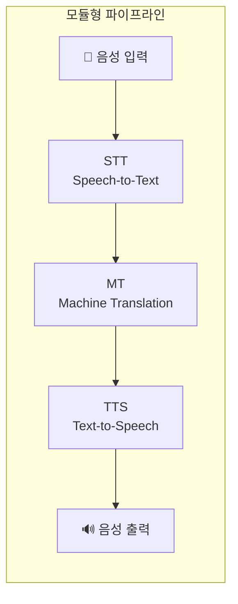
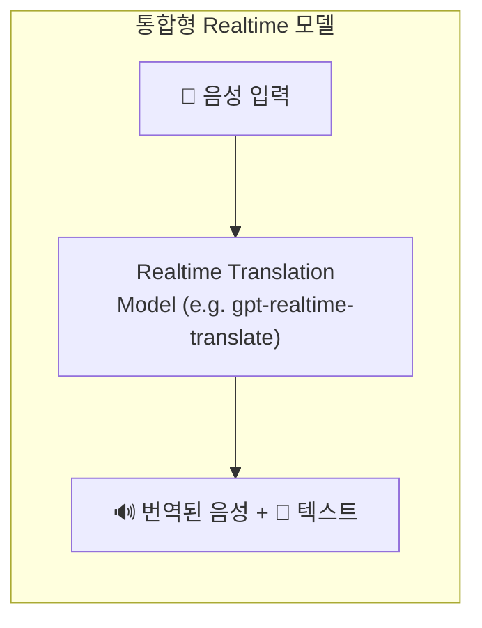
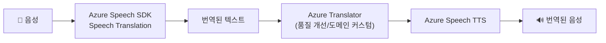
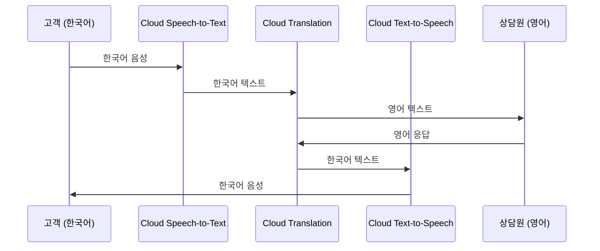
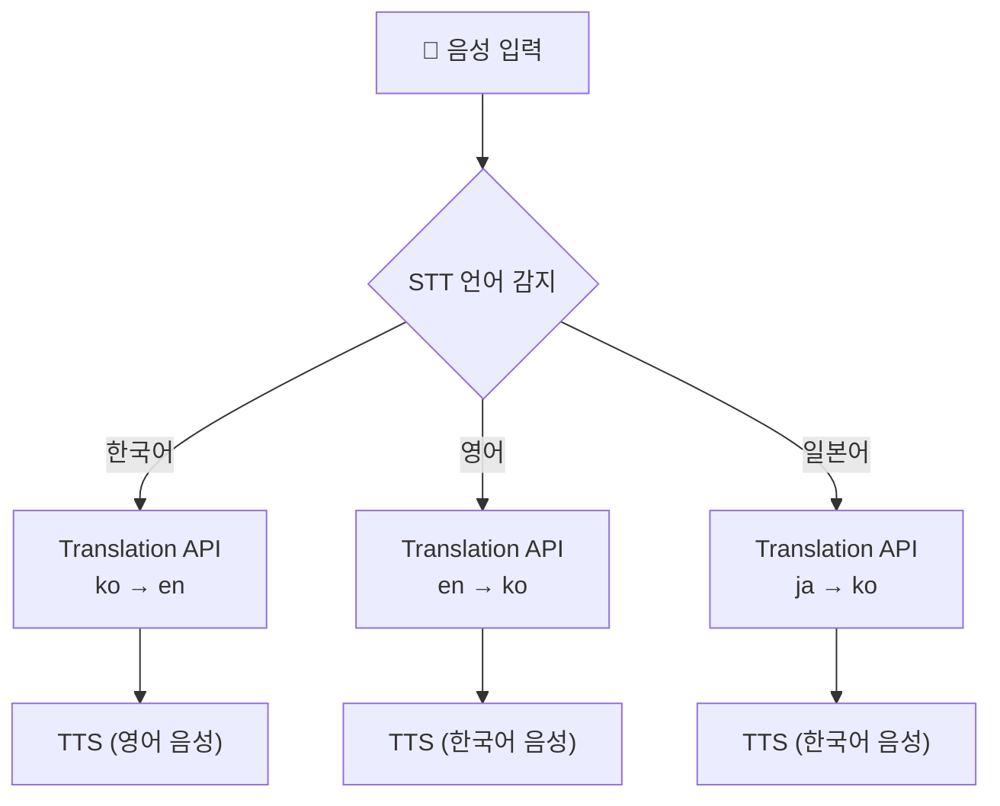
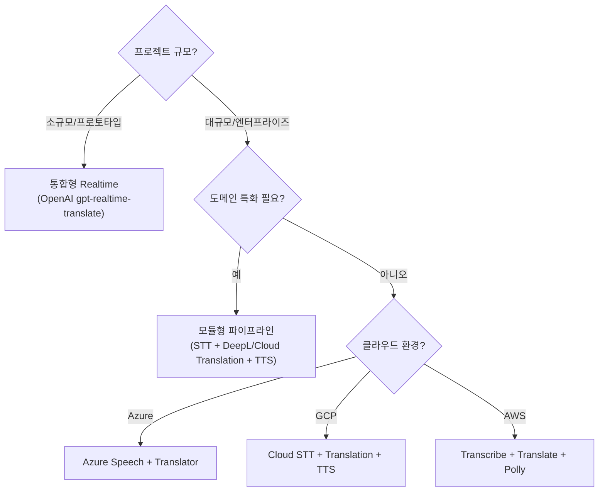

# 실시간 회화 에이전트 구축을 위한 번역 서비스 API와 GitHub 레퍼런스

> **목적**: 실시간 회화 에이전트의 번역 계층을 설계할 때 참고할 주요 번역 서비스 API와 오픈소스 GitHub 저장소를 체계적으로 정리한다.
> **작성일**: 2026-10-20

---

## 목차

1. [실시간 회화 에이전트와 번역 계층의 역할](#1-실시간-회화-에이전트와-번역-계층의-역할)
2. [실시간 음성 번역 특화 서비스](#2-실시간-음성-번역-특화-서비스)
3. [텍스트 번역 API와 회화 에이전트 통합 전략](#3-텍스트-번역-api와-회화-에이전트-통합-전략)
4. [실시간 음성 회화 번역 GitHub 저장소 레퍼런스](#4-실시간-음성-회화-번역-github-저장소-레퍼런스)
5. [실시간 회화 에이전트 번역 모듈 설계 지침](#5-실시간-회화-에이전트-번역-모듈-설계-지침)
6. [시나리오별 추천 조합과 참고 자료 정리](#6-시나리오별-추천-조합과-참고-자료-정리)

---

## 1. 실시간 회화 에이전트와 번역 계층의 역할

### 1.1 기본 구조와 번역 요구

실시간 회화 에이전트는 지연이 거의 없는 상태에서 대화 흐름을 끊김 없이 유지하는 시스템이다. 다국어 환경에서 가장 먼저 등장하는 요구는 **서로 다른 언어를 사용하는 참여자 간의 의미 전달**을 정확하고 빠르게 보장하는 번역 기능이다.

#### 두 가지 설계 방향





| 구분 | 모듈형 STT+MT+TTS | 통합형 Realtime Translation |
|------|--------------------|-----------------------------|
| **장점** | 각 단계별 최적 서비스 선택 가능, 도메인 커스터마이즈 용이 | 설계 단순화, 지연 최소화, 단일 세션 유지 |
| **단점** | 각 단계 지연 누적, 통합 복잡성 | 세밀한 커스터마이즈 어려움, 특정 벤더 종속 |
| **적합 시나리오** | 엔터프라이즈 콜센터, 도메인 특화 | 프로토타입, 교육용, 라이브 이벤트 |

### 1.2 번역 서비스 선택 시 고려 요소

| 요소 | 설명 | 관련 서비스 예시 |
|------|------|------------------|
| **지연 & 스트리밍** | 문장 완성 전 부분 번역 지원 여부 | Azure Speech Translation, OpenAI Realtime |
| **음성 통합** | STT/TTS 별도 연동 필요 여부 | Azure (Speech+Translator), Google (STT+Translation+TTS) |
| **도메인 커스터마이즈** | 용어집·스타일 규칙·번역 메모리 | DeepL (Glossary), Google Advanced (Glossary, Adaptive MT) |
| **라이선스 & 보안** | 데이터 보존 정책, 컴플라이언스 | DeepL (비보존), Google (IAM), Azure (엔터프라이즈급) |

---

## 2. 실시간 음성 번역 특화 서비스

### 2.1 OpenAI Realtime Translation: gpt-realtime-translate

> [!IMPORTANT]
> 통합형 실시간 음성 번역 모델. WebRTC(브라우저)와 WebSocket(서버) 두 가지 연결 방식을 제공한다.

**엔드포인트**: `/v1/realtime/translations`

**연결 방식 비교**:

| 방식 | 적합 환경 | 특징 |
|------|-----------|------|
| **WebRTC** | 브라우저 기반 웹 앱 | 미디어 트랙으로 음성 전송/수신, PCM 직접 처리 불필요 |
| **WebSocket** | 서버(Twilio, SIP, 방송) | 24 kHz PCM16 base64 인코딩 전송, 음성 델타 직접 처리 |

**클라이언트 시크릿 생성 (Node.js Express)**:

```javascript
app.post("/session", async (req, res) => {
  const language = req.body.targetLanguage ?? "en";
  const response = await fetch(
    "https://api.openai.com/v1/realtime/translations/client_secrets",
    {
      method: "POST",
      headers: {
        Authorization: `Bearer ${process.env.OPENAI_API_KEY}`,
        "Content-Type": "application/json",
        "OpenAI-Safety-Identifier": "hashed-user-id",
      },
      body: JSON.stringify({
        session: {
          model: "gpt-realtime-translate",
          audio: { output: { language } },
        },
      }),
    }
  );
  res.status(response.status).json(await response.json());
});
```

**WebSocket 연결 주소**: `wss://api.openai.com/v1/realtime/translations?model=gpt-realtime-translate`

**참고 자료**:
- 🔗 [OpenAI Realtime Translation 가이드 (중국어 번역)](https://github.com/hl8086/openai-developer-doc-zh/blob/main/zh/guides/realtime-translation.md)
- 🔗 [GPT-Realtime-Translate Live Event Interpreter](https://github.com/backblaze-b2-samples/gpt-realtime-translate-live-event-interpreter) — FastAPI + Next.js 기반 라이브 이벤트 통역 시스템

---

### 2.2 Azure Translator + Azure Speech (Foundry Tools)

> [!NOTE]
> Microsoft의 엔터프라이즈급 번역·음성 서비스. 콜센터·다국어 에이전트에 특히 적합하다.

**Azure Translator**:
- 100개 이상 언어 지원
- 실시간·배치 텍스트 번역, 문서 번역
- 언어 자동 감지, 양방향 사전, 커스텀 번역
- 🔗 [Azure Translator](https://azure.microsoft.com/en-us/products/ai-foundry/tools/translator)

**Azure Speech**:
- Speech-to-Text, Text-to-Speech, Speech Translation, 화자 인식
- C#, C++, Java 등 다중 언어 SDK
- 실시간 스트리밍 음성 처리 지원
- 🔗 [Azure Speech](https://azure.microsoft.com/en-us/products/ai-foundry/tools/speech)

**통합 구조**:



**참고 저장소**: 🔗 [Azure Speech SDK C# 샘플](https://github.com/Azure-Samples/cognitive-services-speech-sdk/tree/master/samples/csharp/dotnetcore/console)

---

### 2.3 DeepL API + Voice WebSocket 프로토콜

> [!TIP]
> 고품질 번역과 도메인 커스터마이즈(용어집·스타일 룰·번역 메모리)에 강점. Voice WebSocket으로 실시간 음성 번역도 지원.

**인증**: `Authorization: DeepL-Auth-Key <api-key>`

| 플랜 | 엔드포인트 |
|------|-----------|
| Free | `https://api-free.deepl.com` |
| Pro | `https://api.deepl.com` |

**주요 엔드포인트**:
- `/v2/translate` — 텍스트 번역
- `/v2/document` — 문서 번역
- Voice WebSocket — 실시간 음성 번역 스트리밍

**명세 파일**:
- REST API: `openapi.yaml`
- Voice WebSocket: `voice.asyncapi.yaml`

**참고 링크**:
- 🔗 [DeepL 인증·액세스 문서](https://developers.deepl.com/docs/getting-started/auth)
- 🔗 [Voice WebSocket 프로토콜 명세](https://developers.deepl.com/api-reference/voice/voice.asyncapi.yaml)

---

### 2.4 Google Cloud Translation + Speech-to-Text + Text-to-Speech

> [!NOTE]
> 189개 언어 지원, Basic/Advanced 에디션. 대규모 서비스에 안정적인 선택.

**에디션 비교**:

| 기능 | Basic (v2) | Advanced (v3) |
|------|-----------|---------------|
| 인증 | API 키 | IAM 서비스 계정 |
| Glossary | ❌ | ✅ |
| Batch Translation | ❌ | ✅ |
| Document Translation | ❌ | ✅ |
| Adaptive Translation | ❌ | ✅ |
| TLLM 모델 선택 | ❌ | ✅ |

**통합 파이프라인 (콜센터 시나리오)**:



**참고 링크**:
- 🔗 [Google Cloud Translation](https://cloud.google.com/translate)
- 🔗 [API 개요](https://docs.cloud.google.com/translate/docs/api-overview)
- 🔗 [REST API 레퍼런스](https://docs.cloud.google.com/translate/docs/reference/rest)

---

### 2.5 Amazon Translate

**주요 작업**:
- `TranslateText` — 단일 텍스트 블록 실시간 번역
- `TranslateDocument` — 텍스트/HTML/DOCX 문서 번역

**AWS CLI 예시**:

```bash
aws translate translate-text \
  --region us-east-1 \
  --source-language-code "en" \
  --target-language-code "es" \
  --text "hello, world"
```

**통합 조합**: AWS Transcribe (STT) + Amazon Translate (MT) + Amazon Polly (TTS)

**참고 링크**: 🔗 [Amazon Translate 실시간 번역 문서](https://docs.aws.amazon.com/translate/latest/dg/sync-api.html)

---

### 2.6 Naver Papago & NHN Cloud

> [!WARNING]
> Papago 번역 오픈 API는 **2024년 2월 29일에 지원 종료**되었다. 신규 서비스에서는 사용 불가.

**Papago NMT API (과거)**:
- 엔드포인트: `https://openapi.naver.com/v1/papago/n2mt`
- 29개 언어쌍, 최대 5,000자
- 비로그인 방식 클라이언트 ID/Secret 인증
- 🔗 [Papago NMT API 문서 (아카이브)](https://developers.naver.com/docs/papago/papago-nmt-api-reference.md)
- 🔗 [Papago API 프로파일 (GitHub)](https://github.com/api-evangelist/papago)

**NHN Cloud Public API**:
- 외부 시스템 연동을 위한 REST API
- 번역 특화 서비스는 별도 확인 필요
- 🔗 [NHN Cloud Public API 개요](https://docs.nhncloud.com/en/nhncloud/en/public-api/overview/)

---

## 3. 텍스트 번역 API와 회화 에이전트 통합 전략

### 3.1 STT+MT+TTS 파이프라인 설계 원칙

지연 최소화를 위한 핵심 전략:

1. **STT 스트리밍**: 발화 종료 전 부분 인식 결과 수신
2. **MT 분할 요청**: 문장 경계·구절 단위로 나누어 번역 요청
3. **TTS 부분 합성**: 이전 부분을 먼저 재생하여 인터랙션 지연 감소

### 3.2 주요 텍스트 번역 서비스 비교 표

| 서비스 | 주요 특징 | 커스터마이즈 | 회화 에이전트 적합성 | 문서 링크 |
|--------|-----------|-------------|---------------------|-----------|
| **OpenAI (모델 기반)** | 범용 LLM 번역, 문맥 이해, 복합 작업 동시 수행 | 프롬프트 기반 제어 | LLM 에이전트와 번역을 한 모델에서 처리 → 설계 단순화 | OpenAI Responses/Translations 문서 |
| **Azure Translator** | Foundry Tools, 100개+ 언어, 에이전트형 사용 사례 | Custom Translator + Speech 연동 | 엔터프라이즈 회화 에이전트에 적합 | [링크](https://azure.microsoft.com/en-us/products/ai-foundry/tools/translator) |
| **DeepL API** | 고품질, 용어집·스타일 룰·번역 메모리 | 용어집, 스타일 규칙 | 도메인 특화 전문 용어·브랜드명 번역 | [링크](https://developers.deepl.com/docs/getting-started/auth) |
| **Google Cloud Translation** | 189개 언어, Glossary·Adaptive MT | Glossary, 사용자 정의 모델 | 다국어 콜센터·영상 자막·음성 더빙 | [링크](https://docs.cloud.google.com/translate/docs/api-overview) |
| **Amazon Translate** | TranslateText/Document, AWS 생태계 통합 | 자동 언어 감지 | AWS 마이크로서비스 아키텍처 내 자연스러운 통합 | [링크](https://docs.aws.amazon.com/translate/latest/dg/sync-api.html) |
| **Papago NMT (종료)** | 한국어 중심 29개 언어쌍 | 용어집 (과거) | ⚠️ 오픈 API 종료로 신규 사용 불가 | [링크](https://developers.naver.com/docs/papago/papago-nmt-api-reference.md) |

### 3.3 언어 감지와 다국어 회화 흐름 관리

**음성 기반 언어 감지 → 번역 API 연동 흐름**:



> [!TIP]
> STT 단계에서 이미 언어를 감지할 수 있으므로, 번역 API에서 중복 감지를 피할 수 있다. Azure Speech SDK와 Google Speech-to-Text 모두 다중 후보 언어 설정을 지원한다.

---

## 4. 실시간 음성 회화 번역 GitHub 저장소 레퍼런스

### 4.1 GPT-Realtime-Translate Live Event Interpreter

🔗 **저장소**: [backblaze-b2-samples/gpt-realtime-translate-live-event-interpreter](https://github.com/backblaze-b2-samples/gpt-realtime-translate-live-event-interpreter)

| 항목 | 내용 |
|------|------|
| **스택** | FastAPI (백엔드) + Next.js (프론트엔드) |
| **기능** | 발표자 1명 → N개 언어 동시 번역, 실시간 캡션, 음성 재생 |
| **API** | OpenAI Realtime API (`openai_realtime.py` 래핑) |
| **아카이브** | 원본 음성/트랜스크립트, VTT/SRT 캡션, 번역 음성 → Backblaze B2 저장 |

**배울 수 있는 설계 패턴**:
1. 하나의 소스 음성 → 여러 대상 언어 동시 번역 구조
2. 브라우저 마이크 → OpenAI Realtime 세션 연결
3. 참가자에게 WebSocket/SSE로 번역 결과 스트리밍
4. 이벤트 아카이브를 클라우드 저장소에 구조화 저장

---

### 4.2 local-multilingual-voice-translator

🔗 **저장소**: [dwain-barnes/local-multilingual-voice-translator](https://github.com/dwain-barnes/local-multilingual-voice-translator)

| 항목 | 내용 |
|------|------|
| **스택** | HTML/JS 웹 앱 + LM Studio + Chatterbox TTS |
| **기능** | 23개+ 언어, 로컬 LLM 기반 음성 번역, 실시간 트랜스크립트 |
| **특징** | 클라우드 의존도 최소화, EventSource 기반 TTS 스트리밍 |

**배울 수 있는 요소**:
1. 소스·타겟 언어 선택 UI 설계 & 언어 코드 매핑 패턴
2. EventSource/WebSocket을 이용한 TTS 오디오 브라우저 재생
3. 로컬 LLM+TTS 아키텍처로 클라우드 비용 절감

---

### 4.3 speech-to-speech-translator

🔗 **저장소**: [acyclics/speech-to-speech-translator](https://github.com/acyclics/speech-to-speech-translator)

| 항목 | 내용 |
|------|------|
| **환경** | Linux/Unix 로컬 데스크톱 |
| **구조** | STT + MT + TTS 전통적 파이프라인 조합 |
| **특징** | 오픈소스 구성 요소 + 타사 API 조합, 마이크 입력 → 음성 출력 |

**배울 수 있는 요소**:
1. 로컬 오디오 파이프라인 (마이크 입력 → 음성 출력)
2. 여러 API를 조합한 Speech-to-Speech Translation 코드 구조
3. Linux/Unix 환경에서 의존성 설치·녹음·재생 장치 관리

---

### 4.4 Azure Speech SDK C# 샘플

🔗 **저장소**: [Azure-Samples/cognitive-services-speech-sdk (C# Console)](https://github.com/Azure-Samples/cognitive-services-speech-sdk/tree/master/samples/csharp/dotnetcore/console)

- .NET 8.0+ 콘솔 앱
- 음성 인식, 의도 인식, **번역**, 발음 평가, 키워드 인식 등 다양한 시나리오
- Azure Speech 서비스 구독 키 인증
- Azure 기반 음성 번역 구현 시 필수 참조

---

### 4.5 Papago API 프로파일

🔗 **저장소**: [api-evangelist/papago](https://github.com/api-evangelist/papago)

- Papago NMT 번역, 언어 감지, 문서/웹사이트 번역, 용어집 API 정리
- 29개 언어쌍, 한국어 중심
- ⚠️ 오픈 API 종료로 **과거 설계 분석용** 참고 자료

---

## 5. 실시간 회화 에이전트 번역 모듈 설계 지침

### 5.1 통합형 vs 모듈형 선택 가이드



### 5.2 WebRTC & WebSocket 스트리밍 구조

**브라우저 환경 (WebRTC)**:
```
브라우저 → RTCPeerConnection → SDP Offer → 서버/번역 세션
                                          ↓
브라우저 ← Remote Audio Track ← 번역된 음성 ← 세션 응답
```

**서버 환경 (WebSocket)**:
```
Twilio/SIP → PCM 오디오 → 서버 → 24kHz PCM16 base64 → WebSocket
                                                        ↓
Twilio/SIP ← 번역 음성 ← 서버 ← 음성·텍스트 델타 ← WebSocket 응답
```

### 5.3 코드 예시: OpenAI Realtime Translation WebSocket (Node.js)

```javascript
import WebSocket from "ws";
import fs from "fs";

const apiKey = process.env.OPENAI_API_KEY;
const safetyId = "hashed-user-id";

const ws = new WebSocket(
  "wss://api.openai.com/v1/realtime/translations?model=gpt-realtime-translate",
  {
    headers: {
      Authorization: `Bearer ${apiKey}`,
      "OpenAI-Safety-Identifier": safetyId,
    },
  }
);

ws.on("open", () => {
  console.log("Realtime translation WebSocket connected");

  // 24kHz PCM16 오디오를 base64로 변환하여 전송
  const audioBuffer = fs.readFileSync("input.pcm");
  const base64Audio = audioBuffer.toString("base64");

  ws.send(JSON.stringify({
    type: "input_audio_buffer.append",
    audio: base64Audio,
  }));

  ws.send(JSON.stringify({
    type: "input_audio_buffer.commit",
  }));
});

ws.on("message", (data) => {
  const event = JSON.parse(data.toString());

  if (event.type === "output_audio_delta") {
    const audioBytes = Buffer.from(event.audio, "base64");
    console.log("Received audio delta, length:", audioBytes.length);
  } else if (event.type === "output_text_delta") {
    process.stdout.write(event.text);
  }
});

ws.on("close", () => console.log("WebSocket closed"));
ws.on("error", (err) => console.error("WebSocket error:", err));
```

### 5.4 코드 예시: Azure Speech Translation (C#)

```csharp
using System;
using Microsoft.CognitiveServices.Speech;
using Microsoft.CognitiveServices.Speech.Translation;

class Program
{
    static async Task Main(string[] args)
    {
        var subscriptionKey = Environment.GetEnvironmentVariable("AZURE_SPEECH_KEY");
        var region = Environment.GetEnvironmentVariable("AZURE_SPEECH_REGION");

        var config = SpeechTranslationConfig.FromSubscription(subscriptionKey, region);
        config.SpeechRecognitionLanguage = "ko-KR";
        config.AddTargetLanguage("en");

        using var recognizer = new TranslationRecognizer(config);

        Console.WriteLine("Speak into your microphone.");
        var result = await recognizer.RecognizeOnceAsync();

        if (result.Reason == ResultReason.TranslatedSpeech)
        {
            Console.WriteLine($"Recognized: {result.Text}");
            foreach (var element in result.Translations)
            {
                Console.WriteLine($"Translated into {element.Key}: {element.Value}");
            }
        }
        else
        {
            Console.WriteLine($"Error: {result.Reason}");
        }
    }
}
```

> [!TIP]
> 실시간 스트리밍에는 `StartContinuousRecognitionAsync`를 사용하여 이벤트 기반 처리 구조를 구성한다.

### 5.5 코드 예시: DeepL 텍스트 번역 (Python)

```python
import requests
import os

auth_key = os.environ["DEEPL_AUTH_KEY"]
endpoint = "https://api.deepl.com/v2/translate"

params = {
    "text": "안녕하세요. 실시간 회화 에이전트 번역 테스트입니다.",
    "source_lang": "KO",
    "target_lang": "EN",
}

headers = {
    "Authorization": f"DeepL-Auth-Key {auth_key}",
}

response = requests.post(endpoint, data=params, headers=headers)
response.raise_for_status()

data = response.json()
for translation in data["translations"]:
    print("Translated text:", translation["text"])
```

### 5.6 코드 예시: Google Cloud Translation Advanced (Python)

```python
from google.cloud import translate_v3 as translate

client = translate.TranslationServiceClient()

project_id = "your-gcp-project-id"
location = "global"
parent = f"projects/{project_id}/locations/{location}"

response = client.translate_text(
    request={
        "parent": parent,
        "contents": ["실시간 회화 에이전트 번역 테스트입니다."],
        "mime_type": "text/plain",
        "source_language_code": "ko",
        "target_language_code": "en",
    }
)

for translation in response.translations:
    print("Translated text:", translation.translated_text)
```

---

## 6. 시나리오별 추천 조합과 참고 자료 정리

### 6.1 교육용 실시간 회화 에이전트

| 요소 | 추천 |
|------|------|
| **번역 코어** | OpenAI gpt-realtime-translate (브라우저 WebRTC) |
| **학습 피드백** | GPT-4 계열 LLM 에이전트 (문법·어휘·발음 피드백) |
| **연결 방식** | WebRTC (브라우저 마이크) |
| **참고 저장소** | [GPT-Realtime-Translate Live Event Interpreter](https://github.com/backblaze-b2-samples/gpt-realtime-translate-live-event-interpreter), [local-multilingual-voice-translator](https://github.com/dwain-barnes/local-multilingual-voice-translator) |

### 6.2 콜센터·고객 지원용 회화 에이전트

| 클라우드 | 추천 조합 | 참고 저장소 |
|---------|-----------|------------|
| **Azure** | Azure Speech + Azure Translator + Microsoft Agent Framework | [Azure Speech SDK 샘플](https://github.com/Azure-Samples/cognitive-services-speech-sdk/tree/master/samples/csharp/dotnetcore/console) |
| **GCP** | Cloud STT + Cloud Translation + Cloud TTS + Customer Engagement Suite | [Google Cloud Translation 문서](https://docs.cloud.google.com/translate/docs/api-overview) |
| **AWS** | Transcribe + Translate + Polly | [Amazon Translate 문서](https://docs.aws.amazon.com/translate/latest/dg/sync-api.html) |

### 6.3 회의·웨비나·라이브 이벤트 통역

| 요소 | 추천 |
|------|------|
| **번역 코어** | OpenAI gpt-realtime-translate (다중 언어 세션) |
| **아키텍처** | 1 소스 → N 언어 동시 번역, WebSocket/SSE 스트리밍 |
| **아카이브** | 원본·번역 음성/텍스트, VTT/SRT 캡션 → 클라우드 저장소 |
| **핵심 참고** | [GPT-Realtime-Translate Live Event Interpreter](https://github.com/backblaze-b2-samples/gpt-realtime-translate-live-event-interpreter) |

---

## 부록: 전체 링크 정리

### 서비스 API 문서

| 서비스 | 링크 |
|--------|------|
| OpenAI Realtime Translation | [가이드 (중국어)](https://github.com/hl8086/openai-developer-doc-zh/blob/main/zh/guides/realtime-translation.md) |
| Azure Translator | [제품 페이지](https://azure.microsoft.com/en-us/products/ai-foundry/tools/translator) |
| Azure Speech | [제품 페이지](https://azure.microsoft.com/en-us/products/ai-foundry/tools/speech) |
| DeepL API 인증 | [문서](https://developers.deepl.com/docs/getting-started/auth) |
| DeepL Voice WebSocket | [명세](https://developers.deepl.com/api-reference/voice/voice.asyncapi.yaml) |
| Google Cloud Translation | [제품](https://cloud.google.com/translate) · [API 개요](https://docs.cloud.google.com/translate/docs/api-overview) · [REST](https://docs.cloud.google.com/translate/docs/reference/rest) |
| Amazon Translate | [실시간 번역 문서](https://docs.aws.amazon.com/translate/latest/dg/sync-api.html) |
| Papago NMT (종료) | [API 문서](https://developers.naver.com/docs/papago/papago-nmt-api-reference.md) |
| NHN Cloud | [Public API 개요](https://docs.nhncloud.com/en/nhncloud/en/public-api/overview/) |

### GitHub 저장소

| 저장소 | 설명 |
|--------|------|
| [gpt-realtime-translate-live-event-interpreter](https://github.com/backblaze-b2-samples/gpt-realtime-translate-live-event-interpreter) | FastAPI+Next.js 라이브 이벤트 통역 |
| [local-multilingual-voice-translator](https://github.com/dwain-barnes/local-multilingual-voice-translator) | LM Studio+Chatterbox TTS 로컬 음성 번역 |
| [speech-to-speech-translator](https://github.com/acyclics/speech-to-speech-translator) | STT+MT+TTS 파이프라인 음성 번역 |
| [cognitive-services-speech-sdk (C#)](https://github.com/Azure-Samples/cognitive-services-speech-sdk/tree/master/samples/csharp/dotnetcore/console) | Azure Speech SDK 샘플 |
| [openai-developer-doc-zh](https://github.com/hl8086/openai-developer-doc-zh/blob/main/zh/guides/realtime-translation.md) | OpenAI 문서 중국어 번역 |
| [papago (API Evangelist)](https://github.com/api-evangelist/papago) | Papago API 프로파일 (아카이브) |

---

> **출처**: OpenAI API Docs, Azure AI Foundry, DeepL Developer Docs, Google Cloud Docs, AWS Docs, Naver Developers, NHN Cloud Docs, 각 GitHub 저장소 README
